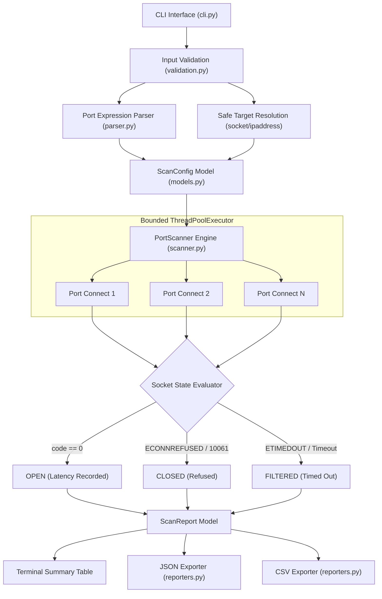
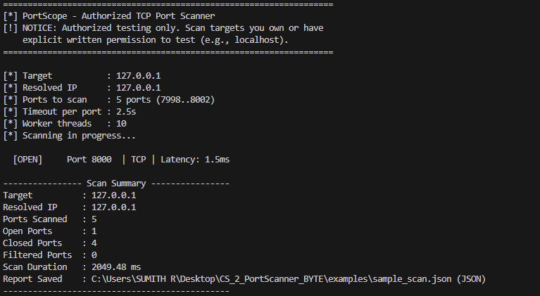
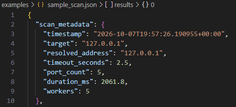
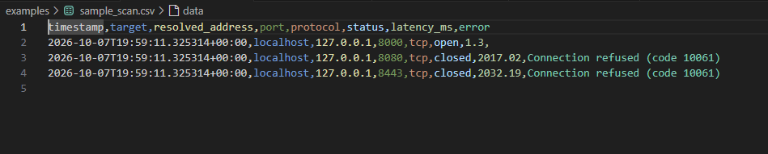
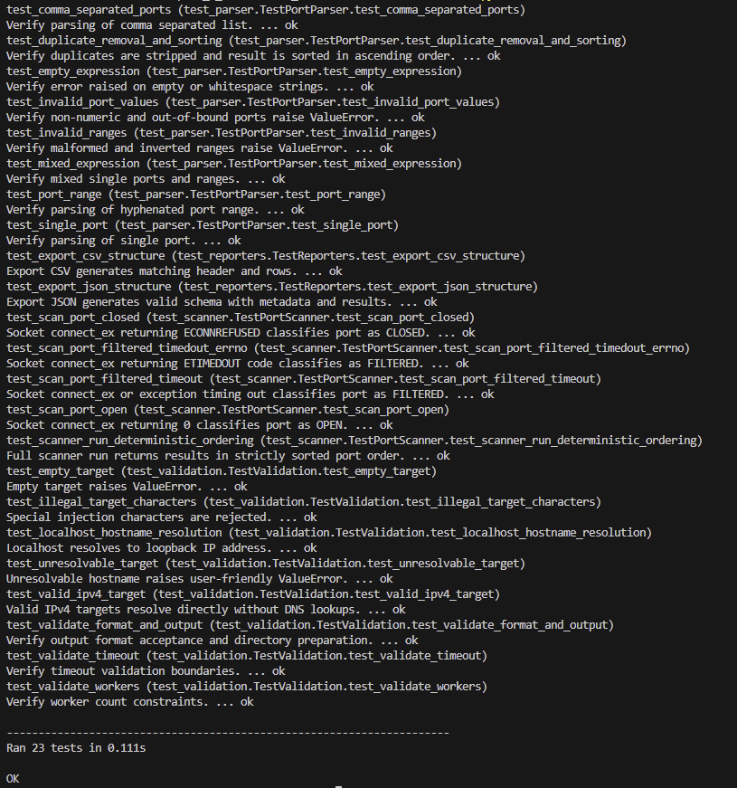
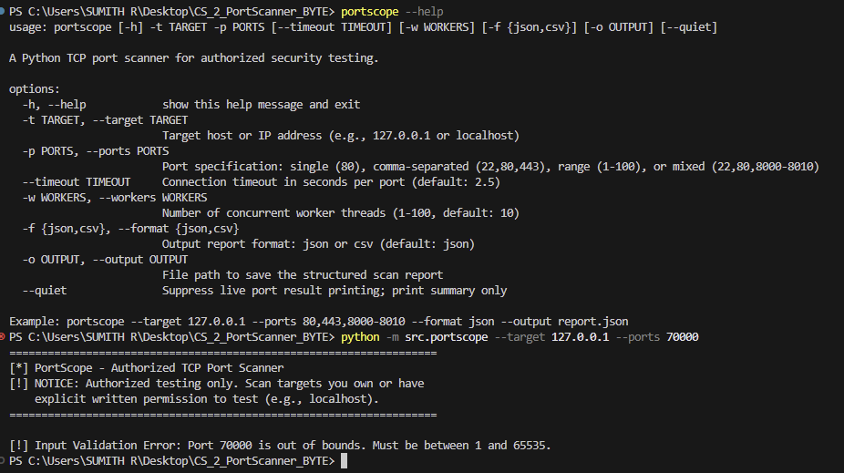

<div align="center">

# 🌐 PortScope

### *Defensive TCP Port Scanner & Network Baseline Auditing Engine*

[](https://github.com/rshamith777-cpu/CS_2_PortScanner_BYTE/actions)
[](https://www.python.org/)
[](LICENSE)
[](SECURITY.md)
[](.github/workflows/tests.yml)
[](https://github.com/rshamith777-cpu/CS_2_PortScanner_BYTE)

<p align="center">
  <b>Built for AICTE Virtual Internship Program (AVIP 2026) – CyberSecurity Task 4</b>
</p>

<p align="center">
  <a href="#-project-overview">Overview</a> •
  <a href="#-key-features">Features</a> •
  <a href="#-system-architecture">Architecture</a> •
  <a href="#-installation--quick-start">Installation</a> •
  <a href="#-usage-guide">Usage</a> •
  <a href="#-visual-demonstrations">Demonstrations</a> •
  <a href="#-test-suite">Testing</a> •
  <a href="#-responsible-use--legal-notice">Legal & Safety</a>
</p>

---

</div>

## 📌 Project Overview

**PortScope** is a modular Python CLI application built to demonstrate fundamental network security mechanics, TCP socket handshakes, port state classification, and structured reporting.

Unlike monolithic scripts, PortScope employs clean software engineering patterns: strict domain models, decoupled token parsers, validated input boundaries, deterministic bounded concurrency, and structured report serialization (JSON & CSV).

> [!IMPORTANT]
> **Defensive Scope Notice:** PortScope is strictly an authorized reconnaissance auditor. It does **not** craft malformed packets, conduct SYN stealth scans, evade firewalls, or exploit services. It is strictly scoped to `localhost`, operator-owned machines, or explicitly authorized targets.

---

## ⚡ Key Features

| Category | Capability | Details |
|---|---|---|
| **🎯 Target Resolution** | Dual Addressing | Supports IPv4, IPv6 loopback, and DNS hostnames safely with command-injection sanitization. |
| **🔢 Flexible Port Syntax** | Expression Parsing | Single ports (`80`), lists (`22,80,443`), ranges (`7998-8002`), or mixed sets with deduplication and sorting. |
| **🔍 State Classification** | RFC-Compliant Handshakes | Accurately identifies **OPEN** (handshake complete), **CLOSED** (connection refused), and **FILTERED** (timeout/unreachable). |
| **⚙️ Bounded Concurrency** | Thread Safety | Controlled parallel scanning via `ThreadPoolExecutor` (1–100 workers) preventing thread exhaustion or network flooding. |
| **📊 Structured Reporting** | Multi-Format Export | Generates timestamped audit records with per-port latency and scan parameters in both **JSON** and **CSV**. |
| **🛡️ Defensive Zero-Dep** | Pure Standard Library | Zero third-party runtime dependencies; runs securely across Windows, Linux, and macOS environments. |

---

## 🏗️ System Architecture



### Directory Structure

```
CS_2_PortScanner_BYTE/
├── .github/
│   └── workflows/
│       └── tests.yml            # Multi-OS CI Workflow
├── examples/
│   ├── sample_scan.json         # Sanitized reference JSON export
│   └── sample_scan.csv          # Sanitized reference CSV export
├── screenshots/
│   ├── 01_localhost_scan.png    # Live scan demo screenshot
│   ├── 02_json_report.png       # JSON artifact verification
│   ├── 03_csv_report.png        # CSV artifact verification
│   ├── 04_unit_tests.png        # Full test suite execution
│   └── 05_help_and_validation.png# Help and error sanitization
├── src/
│   └── portscope/
│       ├── __init__.py          # Package exports & versioning
│       ├── __main__.py          # Entrypoint shim
│       ├── cli.py               # Argument parsing & UI presentation
│       ├── models.py            # Dataclass models & PortStatus enum
│       ├── parser.py            # Port range tokenizer & deduplicator
│       ├── reporters.py         # JSON/CSV structured writers
│       ├── scanner.py           # TCP connect scanner & worker pool
│       └── validation.py        # Input security & parameter boundaries
├── tests/
│   ├── test_parser.py           # Port expression test cases
│   ├── test_reporters.py        # Report schema & serialization tests
│   ├── test_scanner.py          # Mock socket state classification tests
│   └── test_validation.py       # Security sanitization test cases
├── .gitignore                   # Ignores build artifacts & ad-hoc files
├── LICENSE                      # MIT Open-Source License
├── pyproject.toml               # Modern packaging metadata
├── README.md                    # Project documentation
└── SECURITY.md                  # Responsible use & vulnerability policy
```

---

## 🚀 Installation & Quick Start

### 1. Prerequisites
- **Python 3.11+** installed
- Windows PowerShell, Command Prompt, or Linux/macOS Bash terminal

### 2. Setup
```powershell
# Clone the repository
git clone https://github.com/rshamith777-cpu/CS_2_PortScanner_BYTE.git
cd CS_2_PortScanner_BYTE

# Install in editable development mode
pip install -e .
```

You can now use `portscope` from anywhere or run it directly using `python -m src.portscope`.

---

## 💻 Usage Guide

### Command Line Options

```
usage: portscope [-h] -t TARGET -p PORTS [--timeout TIMEOUT] [-w WORKERS]
                 [-f {json,csv}] [-o OUTPUT] [--quiet]
```

| Flag | Parameter | Description | Default |
|---|---|---|---|
| `-t`, `--target` | `<host/ip>` | Target IP address or hostname to audit *(Required)* | *None* |
| `-p`, `--ports` | `<ports>` | Single port, comma-separated list, range, or mixed *(Required)* | *None* |
| `--timeout` | `<seconds>` | TCP connection timeout per port | `2.5` |
| `-w`, `--workers` | `<1-100>` | Number of concurrent worker threads | `10` |
| `-f`, `--format` | `<json/csv>` | Report output format | `json` |
| `-o`, `--output` | `<file_path>`| Save audit output to structured file | *None* |
| `--quiet` | | Suppress individual port logs; print summary table only | `False` |

---

### Port Syntax Examples

| Notation | CLI Syntax | Parsed Ports |
|---|---|---|
| **Single Port** | `-p 80` | `[80]` |
| **Comma-Separated** | `-p 22,80,443` | `[22, 80, 443]` |
| **Port Range** | `-p 7998-8002` | `[7998, 7999, 8000, 8001, 8002]` |
| **Mixed Expressions** | `-p 22,80,8000-8005` | `[22, 80, 8000, 8001, 8002, 8003, 8004, 8005]` |
| **Unsorted & Duplicates** | `-p 80,22,80,1-3` | `[1, 2, 3, 22, 80]` *(Normalized & Sorted)* |

---

### Safe Localhost Demonstration

#### Step 1: Start a test listener in Terminal 1
```powershell
python -m http.server 8000 --bind 127.0.0.1
```

#### Step 2: Audit with PortScope in Terminal 2
```powershell
# Scan localhost around the listener
python -m src.portscope --target 127.0.0.1 --ports 7998-8002 --format json --output examples/sample_scan.json
```

```
===================================================================
[*] PortScope - Authorized TCP Port Scanner
[!] NOTICE: Authorized testing only. Scan targets you own or have
    explicit written permission to test (e.g., localhost).
===================================================================

[*] Target           : 127.0.0.1
[*] Resolved IP      : 127.0.0.1
[*] Ports to scan    : 5 ports (7998..8002)
[*] Timeout per port : 2.5s
[*] Worker threads   : 10
[*] Scanning in progress...

  [OPEN]     Port 8000  | TCP | Latency: 1.1ms

---------------- Scan Summary ----------------
Target          : 127.0.0.1
Resolved IP     : 127.0.0.1
Ports Scanned   : 5
Open Ports      : 1
Closed Ports    : 4
Filtered Ports  : 0
Scan Duration   : 2057.39 ms
Report Saved    : C:\Users\SUMITH R\Desktop\CS_2_PortScanner_BYTE\examples\sample_scan.json (JSON)
----------------------------------------------
```

---

## 📸 Visual Demonstrations

### 1. Localhost Scan Verification
> *Verification of live TCP connect scan across local loopback (`127.0.0.1`), demonstrating detection of active listener port 8000 (`OPEN`) and closed sockets (`CLOSED`).*

<div align="center">
  
</div>

---

### 2. Structured JSON Audit Report
> *Timestamped JSON report artifact containing scan metadata, runtime configuration, duration metrics, and port states.*

<div align="center">
  
</div>

---

### 3. Structured CSV Export
> *Tabular CSV output for integration into SIEM dashboards and baseline tracking spreadsheets.*

<div align="center">
  
</div>

---

### 4. Automated Unit Test Suite
> *Complete unit test execution verifying all 23 test cases spanning parser, validation, scanner, and report modules.*

<div align="center">
  
</div>

---

### 5. CLI Help & Input Sanitization
> *Built-in CLI manual and graceful user-friendly error handling preventing Python tracebacks on invalid input.*

<div align="center">
  
</div>

---

## 🧪 Test Suite

Run the complete test suite locally:

```powershell
$env:PYTHONPATH="src"; python -m unittest discover -s tests -v
```

### Test Coverage Highlights

- **`tests/test_parser.py` (8 tests):** Single ports, comma-delimited tokens, hyphenated ranges, mixed formats, duplicate removal, ascending sorting, and boundary checks (1–65535).
- **`tests/test_validation.py` (8 tests):** IPv4/IPv6 handling, loopback validation, rejection of injection characters (`;`, `&`, `|`), hostname lookup failures, timeout constraints, and worker limits.
- **`tests/test_scanner.py` (5 tests):** Socket state simulation (`OPEN` via connect code `0`, `CLOSED` via `ECONNREFUSED` / `10061`, and `FILTERED` via `ETIMEDOUT` / socket timeout).
- **`tests/test_reporters.py` (2 tests):** JSON schema verification and CSV header/row serialization.

---

## ⚖️ Responsible Use & Legal Notice

> [!CAUTION]
> **LEGAL AND ETHICAL DISCLAIMER**
>
> **PortScope is designed exclusively for authorized baseline verification, defensive auditing, and educational demonstrations on `localhost`, systems owned by the operator, or targets with explicit written authorization.**
>
> Unauthorized port scanning against external systems, organizations, or third-party networks may violate local, federal, and international computer misuse laws (such as the United States Computer Fraud and Abuse Act - 18 U.S.C. § 1030, the UK Computer Misuse Act, and equivalent statutes worldwide).
>
> The developer assumes no liability for damages or legal consequences resulting from unauthorized deployment of this software.

---

## 🎓 AVIP 2026 Internship Details

- **Program:** AICTE Virtual Internship Program (AVIP 2026) – CyberSecurity
- **Module:** Task 4 – Port Scanner
- **Repository Name:** `CS_2_PortScanner_BYTE`
- **Lead Developer:** CyberSecurity Intern
- **Target Policy:** Tested exclusively on `localhost` (`127.0.0.1`) and controlled loopback listeners.
